### About

I fix bugs in open source developer tools and AI agent frameworks. Each PR says how to reproduce the problem, and when the fix touches code it comes with a test that fails without it.

- Informatics student, Honduras.
- Freelance software developer: web apps, mobile apps and business systems, including Odoo ERP migrations with Honduran fiscal localization.
- Internship in agentic AI and automation.
- Cybersecurity student focused on defense. I rebuild attacks in personal labs to understand them and explain how to stop them.

### Accepted upstream contributions

19 merged pull requests in 12 open source projects so far.

| Project | What changed |
|---|---|
| [OWASP Nettacker](https://github.com/OWASP/Nettacker) | [#1867](https://github.com/OWASP/Nettacker/pull/1867) the API key message showed the port instead of the key · [#1866](https://github.com/OWASP/Nettacker/pull/1866) 67 missing Spanish translations |
| [OWASP Cheat Sheet Series](https://github.com/OWASP/CheatSheetSeries) | [#2950](https://github.com/OWASP/CheatSheetSeries/pull/2950) two dead links in Mobile Application Security |
| [Inspect AI](https://github.com/UKGovernmentBEIS/inspect_ai) (created by the UK AI Security Institute) | [#6555](https://github.com/UKGovernmentBEIS/inspect_ai/pull/6555), [#6649](https://github.com/UKGovernmentBEIS/inspect_ai/pull/6649) docs examples that still used a retired Gemini model |
| [flutter_chat_ui](https://github.com/flyerhq/flutter_chat_ui) | [#899](https://github.com/flyerhq/flutter_chat_ui/pull/899) links with `_` in the path were cut off |
| [CrossTL](https://github.com/CrossGL/crosstl) (GPU shader translator) | [#4735](https://github.com/CrossGL/crosstl/pull/4735) vector members of constant buffers came out as scalars in the HIP output |
| [deptime](https://github.com/cschmertz/deptime) (checks what a Python dependency update breaks) | [#49](https://github.com/cschmertz/deptime/pull/49) migration hints for the names MCP SDK 2.0 removed |
| [taken](https://github.com/RogueAlg0/taken) (checks if a GitHub issue is already taken) | [#578](https://github.com/RogueAlg0/taken/pull/578) `--discover --jobs 0` now fails before touching the network · [#585](https://github.com/RogueAlg0/taken/pull/585) the `CITATION.cff` version stays in sync with `pyproject.toml` |
| [sqlalchemy-cubrid](https://github.com/cubrid-lab/sqlalchemy-cubrid) (SQLAlchemy dialect for CUBRID) | [#1387](https://github.com/cubrid-lab/sqlalchemy-cubrid/pull/1387) the async sample always releases its engine · [#1388](https://github.com/cubrid-lab/sqlalchemy-cubrid/pull/1388) importing the basic sample no longer opens a database connection · [#1406](https://github.com/cubrid-lab/sqlalchemy-cubrid/pull/1406), [#1407](https://github.com/cubrid-lab/sqlalchemy-cubrid/pull/1407) the benchmark scripts no longer drop or empty tables they did not create |
| [CUBRID cookbook](https://github.com/cubrid-lab/cubrid-cookbook-python) (Python recipes for CUBRID) | [#591](https://github.com/cubrid-lab/cubrid-cookbook-python/pull/591) the golden coverage check no longer crashes on scripts outside the checkout |
| [hello-algo](https://github.com/krahets/hello-algo) (data structures and algorithms book) | [#2026](https://github.com/krahets/hello-algo/pull/2026) the Dart open addressing hash map no longer loops forever when every bucket is a deleted one |
| [mloda-registry](https://github.com/mloda-ai/mloda-registry) (official plugins for mloda) | [#1618](https://github.com/mloda-ai/mloda-registry/pull/1618) pandas binning rejects complex source columns · [#1619](https://github.com/mloda-ai/mloda-registry/pull/1619) the docs check fails when two Python blocks in one guide define the same test name |
| [Obtainium](https://github.com/ImranR98/Obtainium) | [#3503](https://github.com/ImranR98/Obtainium/pull/3503) 275 Spanish strings that were still in English |

In review: pytest, herdr, mitmproxy, pylint, llama_index, ckan and others.

### Take a look

| Project | What it is |
|---|---|
| [sound-stickers](https://github.com/Dio77799/sound-stickers) | Makes a WhatsApp ready sticker and the short sound that goes with it, in the browser, with nothing uploaded. [Try it](https://dio77799.github.io/sound-stickers/) |
| [resumidor-videos](https://github.com/Dio77799/resumidor-videos) | Turns videos, audio or transcripts into Markdown study notes. Runs 100% local with Ollama and faster whisper, or with your own API key. |
| [eva-agente-local](https://github.com/Dio77799/eva-agente-local) | Personal local agent (CLI, standard library only, Ollama optional): tasks, GitHub, lab notes and content, with a small team of agents and a read only web panel. |
| [orbita-kanban](https://github.com/Dio77799/orbita-kanban) | Kanban board with WIP limits per column and flow metrics (cycle time, lead time). Plain HTML, CSS and JS, no dependencies. |
| [MP3](https://github.com/Dio77799/MP3) | Web music player with play and pause, seek bar and track navigation. Plain HTML, CSS and JavaScript. |
| [portafolio](https://github.com/Dio77799/portafolio) | My portfolio as a retro desktop, with windows, themes and mini games. [Open it](https://dio77799.github.io/portafolio/) |

### What I work on

| Area | Focus |
|---|---|
| Software development | Web and mobile apps, ERP and management systems |
| AI and automation | Local LLMs, agents and workflow automation |
| Cybersecurity | Defensive security, phishing awareness, network auditing in personal labs |
| Networks | Fundamentals, scanning and analysis (Cisco Networking Academy coursework) |

### Stack

   
   
  
  
  

### Security labs

Hands on offensive practice to understand attacks and build better defenses.

### Writing

I publish educational, defense focused cybersecurity articles. Latest: *I lost an account to phishing, so I rebuilt the attack to understand it.*
Read them on [LinkedIn](https://www.linkedin.com/in/james-vel%C3%A1squez-8150b6383/) and [daily.dev](https://app.daily.dev/dio77799).

### Community

I'm an owner of two student communities on GitHub:

* [Informática Administrativa UNAH](https://github.com/informatica-administrativa-unah): free courses on SQL, networking, IT auditing and cybersecurity, with exercises that get checked automatically through GitHub Actions.
* [CEUTEC Ingeniería en Informática](https://github.com/CEUTEC-Ingenieria-en-Informatica): Flutter, Dart and UI design material, free course lists and UI challenges.

Neither is an official university account; they're run by students, for students.

© 2026 James V (Dio77799)

