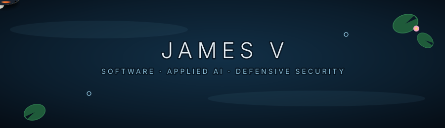

### About

I fix bugs in open source developer tools and AI agent frameworks. Each PR says how to reproduce the problem, and when the fix touches code it comes with a test that fails without it.

- Informatics student, Honduras.
- Freelance software developer: web apps, mobile apps and business systems, including Odoo ERP migrations with Honduran fiscal localization.
- Internship in agentic AI and automation.
- Cybersecurity student focused on defense. I rebuild attacks in personal labs to understand them and explain how to stop them.

### Accepted upstream contributions

9 merged pull requests in 6 open source projects so far.

| Project | What changed |
|---|---|
| [OWASP Nettacker](https://github.com/OWASP/Nettacker) | [#1867](https://github.com/OWASP/Nettacker/pull/1867) the API key message showed the port instead of the key · [#1866](https://github.com/OWASP/Nettacker/pull/1866) 67 missing Spanish translations |
| [OWASP Cheat Sheet Series](https://github.com/OWASP/CheatSheetSeries) | [#2950](https://github.com/OWASP/CheatSheetSeries/pull/2950) two dead links in Mobile Application Security |
| [Inspect AI](https://github.com/UKGovernmentBEIS/inspect_ai) (created by the UK AI Security Institute) | [#6555](https://github.com/UKGovernmentBEIS/inspect_ai/pull/6555), [#6649](https://github.com/UKGovernmentBEIS/inspect_ai/pull/6649) docs examples that still used a retired Gemini model |
| [flutter_chat_ui](https://github.com/flyerhq/flutter_chat_ui) | [#899](https://github.com/flyerhq/flutter_chat_ui/pull/899) links with `_` in the path were cut off |
| [sqlalchemy-cubrid](https://github.com/cubrid-lab/sqlalchemy-cubrid) (SQLAlchemy dialect for CUBRID) | [#1387](https://github.com/cubrid-lab/sqlalchemy-cubrid/pull/1387) the async sample always releases its engine · [#1388](https://github.com/cubrid-lab/sqlalchemy-cubrid/pull/1388) importing the basic sample no longer opens a database connection |

In review: mitmproxy, pylint, CrossTL, ckan and others.

### What I work on

| Area | Focus |
|---|---|
| Software development | Web and mobile apps, ERP and management systems |
| AI and automation | Local LLMs, agents and workflow automation |
| Cybersecurity | Defensive security, phishing awareness, network auditing in personal labs |
| Networks | Fundamentals, scanning and analysis (Cisco Networking Academy coursework) |

### Stack

   
   
  
  
  

### Security labs

Hands on offensive practice to understand attacks and build better defenses.

### Writing

I publish educational, defense focused cybersecurity articles. Latest: *I lost an account to phishing, so I rebuilt the attack to understand it.*
Read them on [LinkedIn](https://www.linkedin.com/in/james-vel%C3%A1squez-8150b6383/) and [daily.dev](https://app.daily.dev/dio77799).

### Community

I started [Informática Administrativa UNAH](https://github.com/informatica-administrativa-unah), a student community for my degree at UNAH CU. It has free courses on SQL, networking, IT auditing and cybersecurity, with exercises that get checked automatically through GitHub Actions. It's not an official university account; it's run by students, for students.

© 2026 James V (Dio77799)

